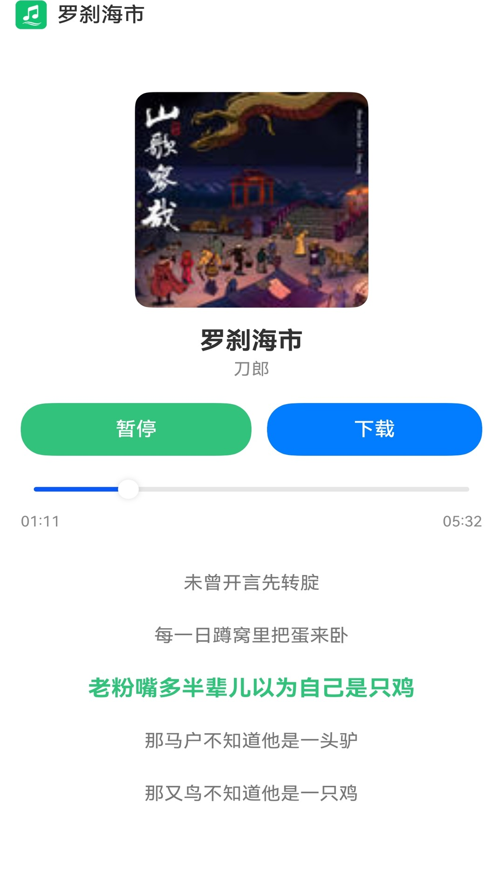
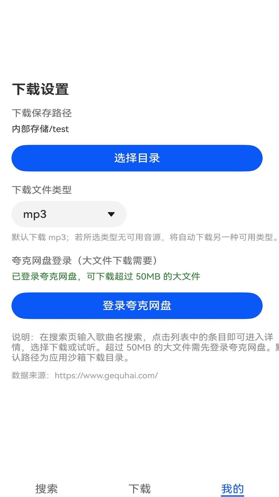

# gequhaiDownloader

鸿蒙原生 App（Stage 模型，ArkTS）项目骨架：歌曲海（https://www.gequhai.com/）歌曲下载器。

## 功能
- **搜索页**：输入歌曲名搜索，展示结果列表，点击条目进入详情，可试听或下载。
- **歌曲详情**：展示封面与歌词，提供 `预览`（试听）与 `下载` 操作。
- **下载列表**：持久化保存下载任务，支持进度显示、暂停/继续、按状态筛选与删除。
- **我的**：配置下载保存路径（默认使用应用沙箱 `filesDir/downloads`）、下载文件类型（`mp3` / `flac`），并可登录夸克网盘以支持大文件下载。

## 截图

| 搜索 | 歌曲详情 | 歌词 | 下载列表 | 我的 |
| :---: | :---: | :---: | :---: | :---: |
|  |  |  |  |  |

> 截图规格 1080×1920（9:16），位于 [`screenshots/`](screenshots/)。

## 说明
- 搜索与下载接口基于歌曲海网页端公开行为（`/s/{keyword}` 搜索页解析、`/api/music` 获取下载链接），仅用于学习与个人使用，请遵守目标站点及相关版权规定。
- 实际下载可用性受目标站点策略影响；部分资源可能需要额外能力（如网盘解析）才能获取高品质文件，本项目实现了网页端直链下载路径。
- 如需在真机/模拟器上写入公共目录，可按需扩展文件选择器与相应存储权限。

## 发布与本地部署

本项目**不提交华为鸿蒙开发者中心（AGC）审核上架**，不提供已签名、可上架的 Release 包，仅用于本地真机/模拟器的调试部署。仓库中不含任何发布签名材料或签名配置；本地安装采用「编译未签名 HAP + HapSign 调试签名安装」的方式。

### 1. 编译未签名 HAP

1. 安装 DevEco Studio / 命令行工具，将 `bin`（含 `hvigorw`）与 SDK `toolchains` 加入 `PATH`，并设置 `DEVECO_SDK_HOME`：

   ```bash
   export PATH=<command-line-tools>/bin:<command-line-tools>/sdk/default/openharmony/toolchains:$PATH
   export DEVECO_SDK_HOME=<command-line-tools>/sdk
   ```

2. 编译（工程未配置 `signingConfig`，Hvigor 会直接产出未签名包）：

   ```bash
   hvigorw assembleHap -p product=default -p buildMode=debug --no-daemon
   ```

   产物：`entry/build/default/outputs/default/entry-default-unsigned.hap`

### 2. 使用 HapSign 部署

HapSign CLI 不包含在本仓库中，请自行获取对应平台的 Portable 版本（Linux x64 / Windows x64）并解压，得到 `hapsign-cli`（Windows 为 `hapsign-cli.exe`）。首次认证需要可交互浏览器完成华为账号登录；登录、验证码、2FA、账号选择与授权同意由用户自行完成。

```bash
# 环境自检（可选）
./hapsign-cli doctor --json

# 设备需开启开发者模式并授权调试；确认 hdc 目标
./hapsign-cli devices list --connected-only --json
# 或使用 hdc：hdc list targets

# 一键完成 认证 → 申请调试证书/Profile → 签名 → 安装
./hapsign-cli deploy \
  --hap entry/build/default/outputs/default/entry-default-unsigned.hap \
  --serial <hdc target> --json
```

也可拆分为两步：

```bash
./hapsign-cli sign --hap <unsigned.hap> --serial <serial> --json
./hapsign-cli install --hap <signed.hap> --serial <serial> --json
```

> `--serial` 取自 `hdc list targets`：可以是 USB 序列号，也可以是 `hdc tconn <ip>:<port>` 连接后的 `IP:PORT`。更换设备时 HapSign 会重新申请匹配该设备的调试 Profile；Token 失效时按提示重新登录。调试签名仅对用户已授权的设备有效，不能用于上架分发。

## 开发
使用 DevEco Studio 打开本目录即可编译运行（HarmonyOS NEXT / API 12+）；本地安装流程见上节。
